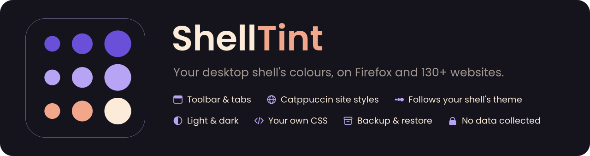

<p align="center">
  
</p>

<p align="center">
  <a href="LICENSE"></a>
  
  
  
</p>

# ShellTint

ShellTint colours your browser with your desktop's colours. It reads the palette your shell generated (Dux Shell, Caelestia, Noctalia, end-4, GNOME, KDE Plasma, pywal, or a matugen file), paints the toolbar with it, and restyles 130+ websites (YouTube, GitHub, X, Reddit, Wikipedia and more) using Catppuccin's userstyles recoloured with your palette. When the shell's theme changes, the browser and open tabs follow within seconds.

ShellTint has two parts: the **extension**, and a small local **helper** that reads your shell's colour files and builds the website styles. The installer below sets both up.

## Features

- **Toolbar, tabs and menus** take your shell's colours; light and dark follow the shell.
- **130+ websites** restyled with Catppuccin's userstyles, recoloured with your palette. A theme change repaints everything in about a second.
- **Works with your desktop's colours**: Dux Shell, Caelestia, Noctalia, end-4, GNOME, KDE Plasma, pywal, or any matugen file — detected automatically.
- **Your own CSS** per site (like Stylus), with syntax highlighting and colour suggestions.
- **Backup & restore** your settings and styles to a zip.
- **Collects no data.** Everything is read and built on your computer.

## How it works

ShellTint is two small programs on your computer, plus the extension.

- **The script** (`shelltint.sh`) puts the *helper* into
  `~/.local/share/shelltint` and write one tiny manifest per browser you
  picked, which is what lets the extension start the helper. Nothing else is
  installed; `./shelltint.sh --uninstall` undoes all of it.
- **The helper** (a Python program) reads your shell's palette from wherever
  your theme keeps it — Dux Shell, Caelestia, Noctalia, end-4, KDE,
  GNOME, pywal or a matugen file — and expands it into a full set of Material
  colours. It then recolours [Catppuccin's](https://github.com/catppuccin/userstyles)
  website styles with that palette, on your computer, and keeps them updated.
  Domains you add for self-hosted sites (your SearXNG, Homepage…) are shared
  through the helper, so every browser learns them.
- **The extension** applies the colours: it paints the toolbar and tabs with
  the palette (Firefox), inserts the recoloured website CSS into pages as you
  open them, runs your own CSS from My styles, and follows light/dark.

**When your theme changes** (you pick another wallpaper or accent in your
shell): the helper notices the palette file change within a second, recolours
the styles for the sites you visit, and pushes the new palette to the
extension. The toolbar and every open tab recolour within a few seconds, no
reload. Your own styles follow automatically because they use `--shelltint-*`
variables. If the browser was closed during the change, it catches up the
next time it starts.


```
 shell colour file                     ShellTint helper (native host, Python)
 (Dux Shell, Caelestia,     ──watch──▶  normalises roles, light/dark
  Noctalia, end-4, matugen file)              │
                                              ▼
                                ~/.cache/shelltint/palette.json
                                              │
                                              ▼
                              builder (Node): Catppuccin userstyles
                              recompiled with the palette
                                              │
                                              ▼
                              ~/.cache/shelltint/userstyles/current/
                                              │
        browser extension  ◀──native messaging──┘
          ├─ browser.theme      → toolbar colours
          └─ scripting.insertCSS → per-site CSS in matching tabs
```

## Prerequisites

- Firefox 140 or newer, or a browser on a 140+ base: Zen, LibreWolf, Floorp, Waterfox.
- Linux.
- Python 3.8+.
- Node.js 18+ with npm (a system package or nvm both work).
- curl.
- flock, from util-linux.
- One supported shell (see [Supported colour sources](#supported-colour-sources)) or a matugen output file.
- The extension's "Access your data for all websites" permission. Firefox may ask for it after install; ShellTint's Overview page shows a button if it is missing. Without it no website can be styled.

Fedora:

```sh
sudo dnf install python3 nodejs npm curl util-linux
```

Debian/Ubuntu:

```sh
sudo apt install python3 nodejs npm curl util-linux
```

Arch:

```sh
sudo pacman -S python nodejs npm curl util-linux
```

## Install

**Step 1 — run the installer.** This is required: it installs the helper and
lets the extension into the browsers you pick.

```sh
curl -fsSL https://raw.githubusercontent.com/Jazzmedo/ShellTint/main/shelltint.sh | bash
```

It shows the browsers it found (config folders, `/opt` installs, AppImages);
press Enter to register the ones you use, or list numbers like `1 3-5`. To
review the script first: `git clone https://github.com/Jazzmedo/ShellTint &&
cd ShellTint && ./shelltint.sh`.

**Step 2 — install the extension** in each browser you picked:

- **Firefox-based** (Firefox, Zen, LibreWolf, Waterfox, Floorp): install from
  <https://addons.mozilla.org/firefox/addon/shelltint/> — they all read AMO.
- **Chromium-based** (Chromium, Chrome, Brave incl. Origin, Vivaldi, Edge,
  Helium, Thorium): `chrome://extensions` → enable **Developer mode** →
  **Load unpacked** → pick the repo's `dist/chromium` folder (or the unzipped
  `shelltint-<version>-chromium.zip` from a release). The ID must show
  `paiglabcdaphmocanlbnikkipilidmfk`.

**Step 3 — restart the browser** and open ShellTint's settings (toolbar
button): the Overview page should say the helper is connected.

### What works where

- **Everywhere:** website styles, My styles, backup & restore, per-site pause.
- **Firefox-based only:** toolbar colours (Chromium has no API for that). Closest
  alternative there: set **Settings → Appearance → GTK**, which follows your
  GTK theme.
- There is no DuckDuckGo browser for Linux yet. Any other fork just needs its
  data-folder name added to the registry at the top of `shelltint.sh`.

| Flag | Effect |
| --- | --- |
| `--browsers LIST` | Skip the question: browser ids, `all`, `auto` (the ones already in use) or `none`. A browser that was removed but left its profile behind shows as "data only" and is neither ticked nor picked by `auto`. |
| `--prefix DIR` | Install the helper to `DIR` instead of `~/.local/share/shelltint`. |
| `--no-build` | Skip the first style build; it runs when the browser connects. |
| `--dry-run` | Print what would be done and change nothing. |
| `--with-matugen-hook` | Print a matugen config snippet that rebuilds styles while the browser is closed. Your matugen config is not edited. |

For the curious: the installer writes one small `shelltint.json` per selected
browser (under its `native-messaging-hosts` or `NativeMessagingHosts` folder —
for example `~/.mozilla`, `~/.config/librewolf/librewolf`,
`~/.config/BraveSoftware/Brave-Origin`, `~/.config/net.imput.helium`), plus a
Flatpak copy under `~/.var/app/<app id>/` when that Flatpak is installed.
Flatpak browsers may not be able to start the helper because of their sandbox.
`./shelltint.sh --uninstall` removes the manifests of the browsers you tick.

## Supported colour sources

| Source | File | Light / dark |
| --- | --- | --- |
| Dux Shell (formerly DankMaterialShell, DMS) | `~/.cache/DankMaterialShell/dms-colors.json` | `isLightMode` in `~/.local/state/DankMaterialShell/session.json` |
| Caelestia | `${XDG_STATE_HOME:-~/.local/state}/caelestia/scheme.json` | the file's `mode` field |
| Noctalia v4 | `${NOCTALIA_CONFIG_DIR:-~/.config/noctalia/}colors.json` | `colorSchemes.darkMode` in `settings.json` |
| Noctalia v5 | `~/.cache/shelltint/sources/noctalia.json`, written by a user template (below) | the template's `mode` |
| end-4 illogical-impulse | `${XDG_STATE_HOME:-~/.local/state}/quickshell/user/generated/colors.json` | inferred: dark when the background is dark |
| KDE Plasma | `~/.config/kdeglobals` (or `kdedefaults/`) | the scheme name's "Dark" / inferred |
| GNOME | read live from gsettings (accent colour, colour scheme) | `color-scheme` (`prefer-dark`) |
| pywal | `~/.cache/wal/colors.json` | inferred: dark when the background is dark |
| Matugen file | any JSON or CSS-variables file you choose | the file's `mode` / `is_dark`, else inferred |

Notes:

- Noctalia v4 only exports 16 roles. ShellTint derives the missing container and surface levels from them, and lists that as a warning on the Overview page.
- The matugen file source accepts flat JSON (`{"primary": "#..."}`), `{"mode": ..., "colors": {...}}`, matugen's nested `{"colors": {"primary": {"dark": ..., "light": ..., "default": ...}}}`, or CSS variables. Accepted names include `--primary`, `--mg-primary`, `--md-sys-color-primary`, `primary` and camelCase such as `surfaceContainerHigh`.

### Auto-detection

With the source set to Auto, ShellTint uses the first one whose file exists and parses, in this order:

```
dms → caelestia → noctalia → end4 → kde → gnome → pywal → matugen
```

To use a different one, open ShellTint → Colours and pick the source. For a matugen file, choose "Matugen file", enter the path and press Check.

### Matugen template

This template writes every colour plus the mode, in a format the matugen file source reads. It was rendered with matugen 4.2.0 in both modes: the output is valid JSON, `{{ mode }}` renders as lowercase `dark` / `light`, and the loop emits all 50 roles.

Save as `~/.config/matugen/templates/shelltint.json`:

```
{
  "mode": "{{ mode }}",
  "is_dark": <* if {{ is_dark_mode }} *>true<* else *>false<* endif *>,
  "colors": {<* for name, value in colors *>
    "{{ name }}": "{{ value.default.hex }}"<* if not {{ loop.last }} *>,<* endif *><* endfor *>
  }
}
```

Add to `~/.config/matugen/config.toml`:

```toml
[templates.shelltint]
input_path = '~/.config/matugen/templates/shelltint.json'
output_path = '~/.cache/shelltint/sources/matugen.json'
```

Then in ShellTint → Colours choose "Matugen file" with the path `~/.cache/shelltint/sources/matugen.json`.

### Noctalia v5 template

Noctalia v5 no longer writes a palette file. Add a user template that writes one. **Not tested on this machine**; Noctalia's template syntax is matugen-style, so the template above should work unchanged.

```toml
[theme.templates.user.shelltint]
input_path = "~/.config/noctalia/templates/shelltint.json"
output_path = "~/.cache/shelltint/sources/noctalia.json"
```

Copy the matugen template above to `~/.config/noctalia/templates/shelltint.json`. The Noctalia source picks the file up automatically.

## Settings

| Setting | Values | Default | Where |
| --- | --- | --- | --- |
| `paletteSource` | `auto`, `dms`, `caelestia`, `noctalia`, `end4`, `kde`, `gnome`, `pywal`, `matugen` | `auto` | Colours |
| `customPalettePath` | path to a JSON or CSS file | empty | Colours (Matugen file) |
| `mode` | `follow`, `dark`, `light` | `follow` | Colours |
| `toolbarTheming` | on / off | on | Overview, popup |
| `toolbarStyle` | `tonal`, `vivid` | `tonal` | Colours |
| `websiteStyling` | on / off | on | Overview, Websites, popup |
| `disabledSites` | site list | empty | popup; managed under Websites → Paused sites |
| `siteInstances` | site id → one hostname or URL per line | empty | Websites → Self-hosted sites |
| `autoCheckUpdates` | on / off | on | Maintenance |

A paused site covers its subdomains: pausing `youtube.com` also pauses `m.youtube.com`.

### Self-hosted sites

Four Catppuccin styles are written for software you host yourself, so upstream
can only name a placeholder address (`homepage.example.com`). Put your own
address under **Websites → Self-hosted sites** and that style starts applying:

| Style | Notes |
| --- | --- |
| SearXNG | |
| Homepage | Already matches any host starting `homepage.`, e.g. `homepage.home.internal`. |
| boringproxy | |
| OpenMediaVault | |

A line is a hostname (subdomains included) or a full URL to style only that
path. To change how one of them looks, write your own CSS for it under **My
styles**.

Homepage needs one extra piece. It paints the page with
`html { background-color: rgb(var(--bg-color)) }`, an `r g b` triplet, and the
Catppuccin style puts a hex colour there — an invalid `rgb()`, which the browser
drops, leaving Homepage's stock slate behind the themed cards. Paste
[`docs/styles/homepage.css`](docs/styles/homepage.css) into a new style under
**My styles** to set the colour directly and match the rest of the desktop.

## My styles

Write your own CSS for any site, like Stylus. Open ShellTint → My styles → New style, or click the toolbar button on a site and choose "New style for this site".

- **Sites:** one per line. A hostname such as `example.com` covers its subdomains, a URL such as `https://example.com/forum/` covers only pages under it, and `*` means every site. Lines starting with `#` are comments.
- **CSS:** plain CSS, applied after the Catppuccin style so your rules win ties. Use `!important` where a site's own CSS is more specific.
- **Replace the Catppuccin style:** turn on "Turn off the Catppuccin style on these sites" to use only your CSS there.
- **Shell colours:** every style can use the palette as variables, and pages update when the shell changes theme:

  ```css
  body {
    background: var(--shelltint-surface) !important;
    color: var(--shelltint-on-surface) !important;
  }
  a { color: var(--shelltint-primary) !important; }
  ```

  Material roles are `--shelltint-<role>` (`primary`, `on-primary`, `primary-container`, `secondary`, `tertiary`, `error`, `surface`, `on-surface`, `surface-container`, `surface-container-high`, `outline` and more). Once website styles are built, Catppuccin's recoloured slots are available too, as `--shelltint-ctp-<slot>` (`base`, `mantle`, `crust`, `text`, `mauve`, `blue` and so on). The editor lists them all with swatches.
- **Editor:** CSS is syntax-highlighted, and suggestions for properties, common values and the `--shelltint-*` variables pop up as you type (Ctrl+Space opens them anywhere). ↑/↓ pick, Enter or Tab accepts, Esc closes.
- **Backup:** Maintenance → Back up to zip saves your settings and every style, each as its own `.css` file. Restore from zip adds the styles in the backup, replaces those you still have with the backed-up version, keeps the rest, and applies the backed-up settings.
- Styles are stored in the extension and work even when the helper isn't running. Pausing a site or turning off website styling also turns off your styles there.

## Rebuilds

- While the browser runs, the helper watches the active source's files. When they change and settle, it writes a new palette, recolours the toolbar and rebuilds the website styles in the background. Open tabs switch to the new styles without a reload.
- When the browser connects, the helper checks Catppuccin for new userstyles, at most once every 10 minutes (turn off with `autoCheckUpdates`).
- To rebuild while the browser is closed, add ShellTint's hook to matugen (print the snippet with `./shelltint.sh --with-matugen-hook`):

  ```toml
  post_hook = '~/.local/share/shelltint/builder/scripts/matugen-hook.sh'
  ```

- Manual: ShellTint → Maintenance → Rebuild styles now, or Check Catppuccin for updates.

## Troubleshooting

**Helper not connected**

- Check that `~/.mozilla/native-messaging-hosts/shelltint.json` exists and its `path` points at an existing, executable `shelltint_host.py`.
- Check that `python3` is on your PATH.
- Restart the browser after installing the helper.
- Flatpak and Snap browsers run sandboxed. They need the manifest inside their sandbox and may not be able to start the helper at all; a native package is recommended.

**Zen opens with no data:** newer Zen keeps its profile in `~/.config/zen`, but it uses `~/.zen` instead whenever that folder exists, so a stray `~/.zen` hides your profile (the data itself is untouched). The installer never creates `~/.zen` (or `~/.floorp`, `~/.waterfox`, `~/.librewolf`) any more and removes the leftover it used to make. If you still have one, check that it holds only `native-messaging-hosts/shelltint.json`, delete that folder, and restart Zen. Zen also reads native messaging manifests from `~/.mozilla/native-messaging-hosts`, which the installer writes.

**No source detected**

- Open ShellTint → Colours; the detected-sources list shows each file ShellTint looked for and why it was rejected.
- Make sure the shell has generated a palette at least once (change the wallpaper or theme).
- Otherwise use the Matugen file source.

**Some styles failed or a site looks wrong**

- Build output is in `~/.cache/shelltint/build.log`. Failed styles are also listed under Websites.
- Pause the site from the popup.

**Reset the website styles**

```sh
rm -rf ~/.cache/shelltint/userstyles
```

Then use Maintenance → Rebuild styles now.

## Uninstall

```sh
./shelltint.sh --uninstall          # a checklist: pick what to remove
./shelltint.sh --uninstall --purge  # same, with cache and settings ticked too
```

The checklist lists only what is on your computer: one row per browser that has ShellTint's manifest, the helper (`~/.local/share/shelltint`), the styles cache (`~/.cache/shelltint`) and your settings (`~/.config/shelltint`). Firefox-based browsers (Firefox, Zen, Floorp, Waterfox) share one manifest, `~/.mozilla/native-messaging-hosts/shelltint.json`, so each installed one gets a row and the shared file is removed only when all of them are ticked; untick Zen and it stays, with a note saying why. Everything is ticked except the cache and settings, which `--purge` ticks for you. Use ↑↓ or j/k to move, space to tick, `a` for all or none, enter to remove, `q` to cancel. Without a terminal (a script, CI) there is no checklist and it removes the ticked-by-default set. `--dry-run` shows what would go.

Then remove the extension from `about:addons`.

## Privacy and permissions

ShellTint collects no data and sends nothing anywhere. The extension talks only to the local helper. The helper's only network access is downloading Catppuccin's public userstyles:

- <https://github.com/catppuccin/userstyles/releases/download/all-userstyles-export/import.json>
- <https://userstyles.catppuccin.com/lib/std/v1.less>

| Permission | Why |
| --- | --- |
| `nativeMessaging` | Talk to the local helper that reads the shell's colour files and serves the compiled CSS. |
| `theme` | Colour the toolbar, tabs and menus. |
| `scripting` + access to all websites | Insert the site CSS into pages that a style matches. |
| `webNavigation` | Notice navigations and frames, so styles apply early and follow in-page navigation. |
| `storage` | Keep your settings. |

## Development

```sh
node --test "builder/test/*.test.mjs"
python3 -m unittest discover -s host/tests
./scripts/package.sh    # web-ext lint + Firefox zip, Chromium build (dist/chromium) and zip
./release.sh --dry-run  # tests and package only; ./release.sh tags, pushes and publishes a GitHub release
```

To add a colour source, see [docs/adapters.md](docs/adapters.md). The helper protocol is in [docs/protocol.md](docs/protocol.md).

## Credits

- ShellTint by Jazzmedo.
- Based on [MatugenFox](https://github.com/Ubaidullah-Web-Dev/MatugenFox) by Ubaid, MIT.
- Website styles from [Catppuccin userstyles](https://github.com/catppuccin/userstyles), MIT.
- Compiled with [less](https://lesscss.org/) and [postcss](https://postcss.org/).

## License

MIT. See [LICENSE](LICENSE).
